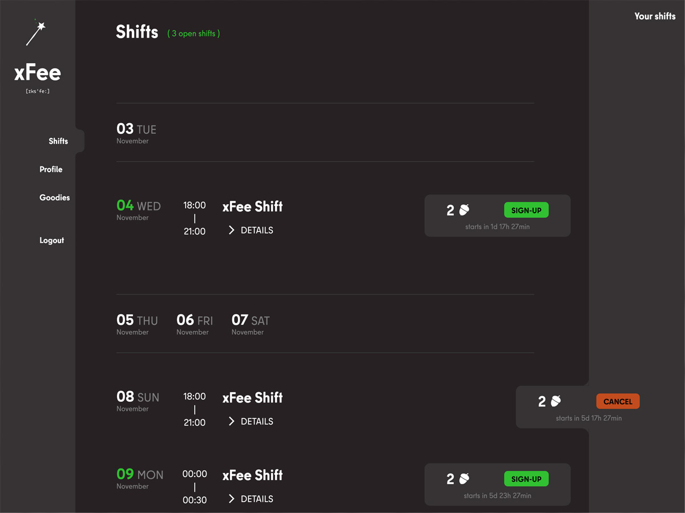

# xFee



A system for handling volunteer shifts and thank-you goodies.

Use-case:
You sign-up for a shift.
You finish the shift and receive acorns for it.
If you have enough acorns, you can pick a goodie and receive a pick-up code.
With that code you can pick-up your goodie with the help of an admin.

## Features

- Shift sign-up
- Goodie shop with pick-up functions
- Minimal data collection & self cleaning
- Cancel & undo functions
- Extensive admin tools

## Installation

Build docker:

```
./docker/build-prod.sh
```

Development:

```
./docker/build.sh
```

TODO: Reverse proxy setup, Authentik setup

Finish the WordPress installation and activate the theme. xFee creates all the necessary pages and preferences 🧚

## User roles

- author: Logged in user
- editor: Admin for shifts, goodies and pick-ups
- administrator

## TODOs

- Debug and error handling (use global debug option)
- Make responsive
- Clean-up css
- Refactor JS (Mayve move to modules, like countdown to shift)
- Shrink WP (Remove media-upload, plugins, ...)
- Limit user shift sign-ups (use global max shift option)
- Cancel goodie option
- Allow admins to finish a shift
- Access hardening
- Editor shift overview, remove assignment select from single shift

## Data structure

### User array

Via get_all_users()

```
'id' => 0,
'name' => '',
'user_email' => '',
'signed_count' => 0,
'acorns' => [],
'pick_up_count' => 0,
'pick_ups' => [
  [
    'user_id' => 0,
    'option' => '',
    'acorns' => [],
  ]
],

```

### Goodie array

Via get_goodie_fields($goodie_id)

```
[
  'name' = '';
  'in_stock' = 0;
  'details_markdown' = '';
  'details_html' = '';
  'image_html' = '';
  'image_url' = '';
  'compensation' = 0;
  'options' => [
    'basic' => 0,
  ],
  ['pick_ups'] = [
    [
      'user_id' => 0,
      'goodie_name' => ''
      'option' => '',
      'reserve' => 0,
    ]
  ]
]
```

Via get_all_goodies()

```
[
  'id' => 0,
  'name' = '';
  'in_stock' = 0;
  'details' = '';
  'image' = '';
  'compensation' = 0;
  'options' => [
    'basic' => 0,
  ],
  ['pick_ups'] = [
    [
      'user_id' => 0,
      'goodie_name' => ''
      'option' => '',
      'reserve' => 0,
    ]
  ]
]
```

### Shift array

Via get_all_shifts()

```
[
  'id'            => 0,
  'name'          => '',
  'date'          => '',
  'time_from'     => '',
  'time_to'       => '',
  'details_html'  => '',
  'compensation'  => 0,
  'signature'     => '',
  'weekday'       => '',
  'assign_id'     => 0,
  'done'          => false,
]
```

Via get_user_shifts($user_id)

```
[
  'shift_id'      => 0,
  'name'          => '',
  'date'          => '',
  'details_html'  => '',
  'time_from'     => '',
  'time_to'       => '',
  'compensation'  => 0,
  'signature'     => '',
  'weekday'       => '',
  'assign_id'     => 0,
  'done'          => false,
  'assigned'      => false,
  'status'        => false,
]
```

Via get_shift_fields($shift_id)

```
[
  'id'                => 0,
  'name'              => '',
  'details_markdown'  => '',
  'details_html'      => '',
  'time_from'         => '',
  'time_to'           => '',
  'compensation'      => 0,
  'signature'         => '',
  'dates'             => [
    'date'      => '',
    'assign_id' => 0,
    'time_from' => '',
    'time_to'   => '',
    'signature' => '',
    'done'      => false,
  ],
]
```

### Pick-ups

Via get_user_pick_ups($user_id)

```
$user_pick_ups = [
  [
  'goodie_id' => 0,
  'goodie_name' => 0,
  'option' => '',
  'acorns' => [],
  'code' => 0,
  ],
]
```

Via get_post_meta($goodie_id, 'goodie_fields')

```
$goodie_fields['pick_ups'] = [
  'user_id' => 0,
  'goodie_name' => '',
  'option' => '',
  'reserve' => 0,
  'code' => 0,
]
```

### Last pick-ups

Via get_pick_up_trash()

```
[$current_user_id] = [
  'user_id' => 0,
  'security_key' => 0,
  'goodie_id' => 0,
  'option' => '',
  'code' => 0,
]
```

### Shift status flag

The status flag reflects the phase in time of a shift. It doesn't reflect the state of assignment, that's what the assigned flag is for.

- pre_process: Shift is ready for sign-up
- queue_process: Still ready for sign-up on the same day (urgent)
- begin_process: Shift has started, can still be canceled
- end_process: Shift is running, can be finished
- post_process: Shift has ended, needs to be finished (transfer of acorn)
- done: Shift is finished and ready for deletion

### Shift assigned flag

The assigned flag reflects only if the shift is assigned. If the shift is in the future or in the past is shown by the status flag.

- unassigned: Shift is not assigned
- assigned: Shift is assigned, hurray!
- booked: Shift is assign to current user
